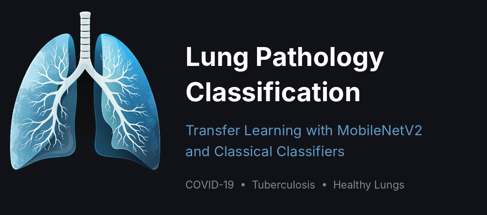

<p align="center">
  
</p>

# Lung Pathology Classification Using Transfer Learning and Classical Methods

This project implements a computer-aided diagnosis system for the
detection of **COVID-19**, **Tuberculosis**, and **Healthy** lungs.
The solution uses the **MobileNetV2** architecture (pre-trained on
ImageNet) as a high-level feature extractor, transforming medical
images into dense mathematical vectors for subsequent classification.

------------------------------------------------------------------------

## Background and Motivation

Interpreting chest X-rays is a critical task that can be affected by
visual fatigue. This software aims to provide:

-   **Early detection:** Crucial for preventing fatal outcomes in
    respiratory diseases.
-   **A reliable second opinion:** A validated system with an accuracy
    above 97%.

------------------------------------------------------------------------

## Technical Methodology

### 1. Preprocessing and Normalization

To ensure consistent learning, the following techniques were applied:

-   **Grayscale:** Images were normalized to black and white to
    highlight tissue densities and remove irrelevant color
    information.
-   **Focused cropping:** Images were manually cropped to the thoracic
    region to remove peripheral visual noise.

------------------------------------------------------------------------

#### 1.1. Dataset and Preprocessing

The model was trained on a **custom compilation of multiple public datasets**, selected for their clinical diversity and the quality of their chest X-rays. This integration improved the system's robustness and its ability to generalize across different pathological patterns.

##### Engineering Note

A **focused cropping process** was applied to the thoracic region of each image.
This strategy forces the model to concentrate exclusively on the **textures, densities, and morphological patterns of the lung parenchyma**, removing irrelevant peripheral visual information. As a result, the model achieved a **significant improvement in accuracy and stability**, especially when differentiating between pathologies with similar appearances.

##### Datasets Used

- **[https://www.kaggle.com/datasets/tawsifurrahman/covid19-radiography-database]**
- **[https://www.kaggle.com/datasets/prashant268/chest-xray-covid19-pneumonia]**
- **[https://www.kaggle.com/datasets/tawsifurrahman/tuberculosis-tb-chest-xray-dataset]**
- **[https://www.kaggle.com/datasets/yasserhessein/tuberculosis-chest-x-rays-images]**


------------------------------------------------------------------------

### 2. Feature Extraction

**MobileNetV2** was used without its final classification layer
(`include_top=False`):

-   **Strategy:** The base model was kept frozen to preserve the
    ImageNet weights.
-   **Dense vectors:** A `GlobalAveragePooling2D` layer was applied
    to reduce the spatial feature maps.
-   **Output dimension:** The final result of this process is a
    **1280-dimensional dense vector** for each image, which captures
    the morphological essence of the X-ray in a compact and efficient
    way.

------------------------------------------------------------------------

## Results and Model Comparison

The 1280-dimensional dense vectors were used as input for three
classical classifiers. Performance was evaluated on a test set of
**560 images**.

| Algorithm          | Accuracy | Precision (Avg.)  | F1-Score (Avg.)  |
|--------------------|----------|-------------------|------------------|
| **SVM (SVC)**      | 0.9768   | 0.98              | 0.98             |
| **Random Forest**  | 0.9750   | 0.97              | 0.97             |
| **KNN**            | 0.9411   | 0.94              | 0.94             |


### Best Model Analysis (SVM)

The **Support Vector Machine (SVM)** model stood out for its ability
to generalize on high-dimensional vectors:

-   **COVID-19:** Precision 0.95 / Recall 0.99\
-   **Tuberculosis:** Precision 0.99 / Recall 0.98 (F1-Score: 0.99)

------------------------------------------------------------------------

## Requirements and Installation

-   **Python:** 3.10.19\
-   **Node.js:** v22.21.1\
-   **npm:** 10.9.4

### Environment Setup (Conda)

``` bash
# Environment for training and feature extraction
conda env create -f general.yml

# Environment for the backend and graphical visualization
conda env create -f grafico.yml

# Install Node.js dependencies
cd ../frontend && npm install
```

------------------------------------------------------------------------

## Running the Application

Once the environments and dependencies are set up, the system can be run locally by following the steps below.  
The architecture is split into a **backend** and a **frontend**, which must be started independently.

### Backend

The backend exposes the inference and processing services through an API built with **FastAPI**.

> By default, the backend runs in development mode with automatic reloading when the code changes.

#### Steps to start the server

```bash
cd backend/
uvicorn app.main:app --reload
```

### Frontend

The user interface is built with modern web technologies and handles uploading X-rays and displaying the results.

> Once started, the application will be available in the browser at the URL shown in the console.

#### Steps to start the server

```bash
cd frontend/
npm run dev
```


------------------------------------------------------------------------

## Project Structure

-   **/src**: Scripts for vector extraction (1280 dimensions) and
    training.
-   **/backend**: Server logic in Node.js for inference processing.
-   **/frontend**: User interface for uploading X-rays.


------------------------------------------------------------------------
## Contributors


-   **\[Kevin Merlin Cabrera Coyotzi\]** - \[https://github.com/WPA-PROGRAMMING\]\
-   **\[Dulce Anahí Luna García\]** - \[https://github.com/Dulce-Luna\]
-   **\[Salvador Eugenio Ayala Raggi\]** - \[https://github.com/WPA-PROGRAMMING\]\
-   **\[Lauro Reyes Cocoletzi\]** - \[https://github.com/Lauro-tensor\]
